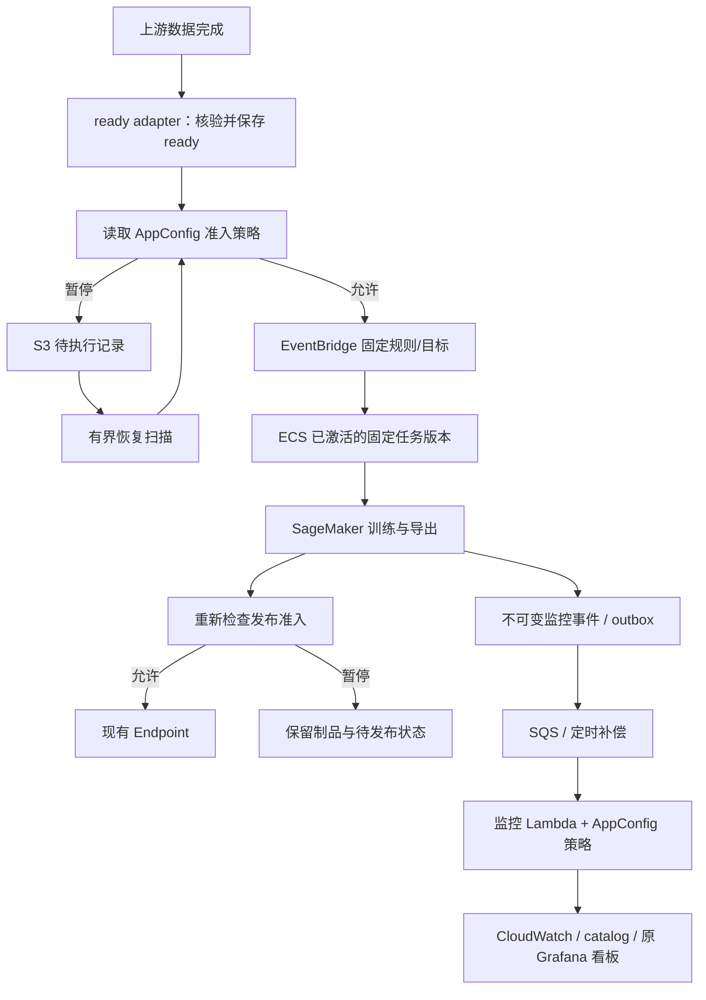

# Spec 031 设计：发布所有权与运行策略迁移

状态：2026-10-31 已授权实施；代码与本地验证见 tasks.md、verification.md，生产迁移见 operations.md。

## 1. 依据和设计边界

Source: [requirements](requirements.md)；doku-train `823bcbf` 的 executor/ready_event/daily_pipeline，doku-monitoring `89e4174` 的 model_metrics_runtime/reconcile，doku-iac `71b0470` 的 tf_daily_pipeline、model_monitoring、tf_endpoint；另参考 IaC/notifier 已有 code_owner=dkd 交接规则。下文新增接口、路径和默认值均为本次设计提案 [INFERRED]。

单份跨仓权威设计保存在本目录。其他仓库实施 PR 只链接本文与本仓验收结果，不复制整份需求。保持现有生产身份，避免重建函数、队列、Endpoint 或清空状态。

## 2. 目标链路

发布系统负责固定 task revision 的激活与回退；日更程序仍只负责模型版本变化。AppConfig 不提供 task ARN、任意 S3 URI、Endpoint 名或镜像地址。

## 3. 所有权和 release 合同

| 对象/字段 | 持续所有者 | 交接方式 |
| --- | --- | --- |
| TF ECS task definition revision | dkd task 发布 | 保存当前 revision；Terraform removed + destroy=false 脱管（实际工具版本须支持），不 deregister；以后由发布系统创建版本 |
| EventBridge target 的 task_definition_arn | 发布系统激活步骤 | IaC 继续管理规则、网络、角色、DLQ、输入转换；仅忽略该精确版本字段，交接后回读实际 target |
| Lambda ZIP/code hash/object version | dkd lambda 发布 | IaC 保留创建用 bootstrap；精确忽略代码字段；函数身份、配置、权限仍由 IaC 管理 |
| AppConfig hosted content/deployment | 受控配置发布流程 | IaC 管 profile/validator/环境和一次性初始化，不持续回写内容版本 |
| Endpoint 模型版本 | 原 daily_pipeline/publish_model | 本次不转交给 dkd，不由 Terraform 管模型日更 |

TF 发布声明与树 `deploy/prod` 分离，建议以 `tf-pipeline/deploy/prod/` 为独立发布目录；实际 dkd source_path/manifest 解析需在预检中验证。禁止假定任意嵌套目录已被 CLI 支持。

不可变 release manifest 记录 pipeline image、training image、inference image、recipe URI/digest、生成的 binding URI/digest、source revision、所需策略 schema 版本。绑定资源与应用配方分开，不再将训练镜像当作基础设施身份。启动默认参数固定到 task revision，EventBridge 只 override ready URI/digest；因此升级配方或镜像不必修改 IaC input_template。

ready adapter 使用相同 release 的配方/window 定义，保留当前 28+1；不另在 Terraform 维护 28+1。迁移期 ready/config 必须记录 recipe digest 并校验匹配；旧 v1 ready 兼容仅限明确的旧配方，不静默重新解释历史日期。先交付双读兼容版本再切生产者，旧 reader 退出后再废弃兼容。

## 4. 必须补齐的发布平台能力

本地已读到 doku-tools `deploy-task/internal/ops/svc.go`：task 目标是 RegisterTaskDefinition only。因此 R3 依赖平台支持受信 target 激活，不能声称现有 task 发布自动生效。

[INFERRED] 平台增加可选的“已登记 EventBridge ECS target”能力：binding 声明允许的 rule、bus、target ID、cluster、family 和 PassRole 范围；业务 manifest 只引用逻辑目标。

1. plan 回读旧 task ARN、target 全配置及摘要；检查新镜像/配置和角色/网络一致性。
2. 使用同一环境/逻辑服务发布锁，注册固定 revision；发布前后比较 target，若出现外部漂移则拒绝覆盖。AWS target 更新不是数据库 CAS，锁与回读不可省略。
3. 原样保留 InputTransformer、DLQ、retry、network 等字段，只激活允许的 task revision；校验 API 部分失败并回读。
4. 记录 prepared/activated/failed/rolled_back，只有回读一致才能声明激活成功。失败恢复旧 target，若回退失败明确报警并保留现场；不自动注销旧版本。
5. IaC 修改同一 target/函数配置与应用发布串行；IAM RunTask 授权稳定 family 的版本范围，仍限制 cluster 和 PassRole，不能持续只授权旧 revision，也不能开放所有 family。

平台扩展位于 doku-tools 的 deploy-api/deploy-task/dkd 与对应测试，是实施阻塞依赖；若尚未交付，本期可以先迁 Lambda/AppConfig，但 ECS 所有权不提前脱管。不得为凑齐三仓范围新增 doku-train 私有 PutTargets 脚本。

## 5. AppConfig 合同和失败策略

建议独立 profile：`doku-train/tf_daily_runtime`、`doku-monitoring/model_metrics_runtime`。身份由 binding 注入；业务仓提供 JSON Schema，IaC 注册对应 validator。内容通过现有配置发布控制面发布；若尚无通用入口须补配置发布能力，不用 Terraform 当日常内容编辑器。

| profile | 字段草案 | 语义 |
| --- | --- | --- |
| tf_daily_runtime/v1 | training_enabled、publication_enabled、recovery_enabled | 新训练准入、部署准入、有界恢复开关 |
| tf_daily_runtime/v1 | recovery_max_items | 每轮恢复数量，迁移初值 1，避免恢复时同时启动多天训练 |
| model_metrics_runtime/v1 | collection_enabled、reconciliation_enabled、dashboard_sync_enabled | 采集/补偿/看板分别暂停 |
| model_metrics_runtime/v1 | max_scan_pages、scan_page_size、max_catalog_models | 从当前生产 binding 等值迁移，schema 检查正整数及边界 |
| model_metrics_runtime/v1 | max_events_per_invocation | 应用处理预算，与 SQS 配置批量数区分；未处理部分不能直接当作已投递 |

reader 在 platforms/运行时适配层，模型/训练数学逻辑不依赖 AWS 配置服务。AppConfig token 按协议续用、遵守返回轮询间隔，Lambda warm invocation 可复用客户端但不能无限沿用过期策略。TF reader 的策略刷新上限为 60 秒；监控每次 invocation 读取新快照，已开始的有界批次在 Lambda 300 秒上限内完成，不跨 invocation 复用快照。实际生效还受 AppConfig deployment 与恢复调度延迟约束，不能承诺点击即停。

每次 invocation/阶段获取合法策略快照；记录版本、拉取时间、摘要和有效期。过期或读取错误不默认 true：禁止新的训练/Endpoint 操作，监控不继续外部投递；待处理证据仍允许写入。已有 SageMaker Job 继续观察并保存成功产物；已经发起 UpdateEndpoint 的等待、健康验证及原有故障回滚必须完成。远程调用失败只输出脱敏错误类别。

新版本启动前要求合法 AppConfig，迁移期旧参数 fallback 必须显式、限期且有日志；最终配置模式禁止静默回退。运行策略不进入模型逻辑 identity，不因暂停/扫描预算变化生成新模型版本；schema/release/ready/配方兼容在操作前检查。

## 6. 暂停与恢复细节

### TF

ready adapter 总是先持久保存已验证的 ready。关闭训练时写 deferred 记录（model_name、ready/recipe digest、data_cutoff、状态、原因），不丢事件；ECS 入口也再检查，覆盖配置切换和事件在途竞态。训练已启动后关闭 training 只阻止下一次新训练，不杀正在运行的 Job。

关闭 publication 时，保存 exported/deferred_publication 及不可变制品；不得写 published。恢复复用原 checkpoint/export/run journal，重新检查目标当前版本和原防旧任务覆盖逻辑，不重新训练。手动 publish/rollback 也通过准入策略；已开始的故障收尾回滚不被关闭开关阻断。

增加有界恢复入口，由现有 ready Lambda 的定时事件调用（建议 5 分钟，调度资源由 IaC 管）。扫描 deferred 并投递受信 ready/恢复请求，复用原运行锁、幂等 key 和重试协议；接受投递不等于完成，记录直到下游确认才结案。多个积压默认先恢复最新 cutoff，较旧项保留为 superseded/待人工回放，不允许旧模型覆盖新模型。恢复扫描必须有持久游标、租约与 budget。

### 模型监控

仅关闭 dashboard_sync 时继续采集指标和 catalog，恢复后刷新同一 UID。关闭 collection 时，先将事件坐标/digest 写入持久 deferred inbox；成功持久化才可 ACK 运输消息，但不写指标 delivery ack。写入失败返回 batchItemFailures。该策略避免长期暂停反复重试将正常消息送入 DLQ。

超出应用 budget 的消息也只能持久转存或返回失败，不能遗漏在成功返回中。恢复通过 deferred inbox 和既有 outbox/source reconcile 重放；幂等由原 event_id/claim/ack 保证。deferred 数据不按短 SQS 保留期删除，清理必须确认 delivery ack；S3 源日志/制品保留期是恢复边界，源已过期需明确报缺失，不能承诺无限回填。

暂停、预算耗尽、配置不可用均单列诊断。应用暂停不能关闭基础设施 DLQ、权限错误、恢复失败告警；本 Spec 不新增电话级别。

## 7. 具体代码改动计划

以下为原始规划。实际独立发布入口为 `tf-pipeline/deploy/prod/`、`tf-ready/deploy/prod/`、monitoring 的 `model-monitoring/deploy/prod/`；发布器以 source_path 定位发布单元。

| 仓库 | 新增/修改 | 工作 |
| --- | --- | --- |
| train | `tf-pipeline/deploy/prod/task-definition.yml`、`release.json` | 独立编排声明、固定镜像/配方版本；不覆盖树任务 |
| train | `tf-ready/deploy/prod/lambda.yml`、`scripts/package_tf_ready.py` | ready adapter 确定性打包与独立 Lambda 发布 |
| train | `config/tf_daily_runtime.schema.json`、`config/tf_daily_runtime.defaults.json` | 应用运行策略合同与初始化模板，不写物理 ARN/密钥 |
| train | `recommend_tf/platforms/runtime_policy.py` | TF 平台 reader/验证/审计，不导入树模型内部实现 |
| train | `platforms/sagemaker/executor.py`、`daily_pipeline.py`、`ready_event.py`（均在 recommend_tf 下） | 准入检查、release/config 分离、deferred 状态及配方摘要一致性 |
| train | `recommend_tf/platforms/sagemaker/recover_daily.py` | 同一幂等协议的有界恢复，不建第二套选模/发布器 |
| train | `recommend_tf/train/tests/test_runtime_policy.py`、`test_daily_recovery.py`，已有 ready/rollout tests | 暂停/失败/恢复、旧版本不覆盖及离线不依赖 AppConfig |
| monitoring | `model-monitoring/deploy/prod/lambda.yml` | 独立源码发布单元，通过 binding 选择现有函数 |
| monitoring | `scripts/package_model_monitoring.py` | 补确定性 ZIP、schema/所需模块打包及制品摘要；不打包 notifier |
| monitoring | `config/model_metrics_runtime.schema.json`、`.defaults.json`；`src/pkg/model_metrics_policy.py` | 运行策略合同/读取/验证 |
| monitoring | `src/pkg/model_metrics_runtime.py`、`model_metrics_reconcile.py`、新增 `model_metrics_deferred.py` | 资源 binding 与策略分离、分阶段暂停、有界转存和恢复 |
| monitoring | `tests/test_model_metrics_runtime.py`、新增 `test_model_metrics_policy.py`/`test_model_metrics_deferred.py` | SQS ACK 边界、暂停超过重试次数、配置过期、cursor/claim 恢复 |
| iac | `modules/tf_daily_pipeline/{main,trigger,variables,outputs}.tf`、对应 mock tests | ECS 脱管、target 字段交接、family 范围 IAM、受信发布 binding |
| iac | `envs/prod/tf_endpoint/{pipeline,ready_adapter}.tf` | 原地接线、ready Lambda code ownership、恢复调度及最小权限 |
| iac | `modules/model_monitoring/{main,variables,outputs}.tf`、`envs/prod/model_monitoring/main.tf` | 代码 bootstrap/忽略字段、去除业务预算、保留资源边界 |
| iac | 环境 AppConfig profile 装配及 `scripts/gen-dkd-deploy-binding.sh`、`scripts/gen-tf-daily-binding.py` | profile/validator、最小读取权限、发布目标与 code_owner 生成；不手改生成 binding |

具体环境 AppConfig 文件先沿用现有模块/profile map；不在 shared/prod 两处重复创建同名 profile。monitoring 根全量测试与 train make check 仍为合入要求；IaC formatter/validate/mock tests/无破坏 plan，平台增加激活和回滚故障注入。

## 8. 生产迁移顺序与门槛

| 阶段 | 操作 | 进入下一阶段的证据 |
| --- | --- | --- |
| 0 盘点 | 读取 live task/target/IAM/Lambda hash、AppConfig、Endpoint config、catalog/游标与告警；记录独立 TF 未含 PR #30 的事实 | 不可变基线清单、回退 artifact 可下载；不依赖过期本地 tfvars |
| 1 补平台 | 支持 task target 激活与回退，验证 lambda source_path/制品边界、配置发布流程 | 隔离目标故障注入成功，不能只靠 task 注册成功 |
| 2 加资源与策略 | 加 scoped IAM、profile/schema、bootstrap 等值策略及 deferred 前缀/恢复调度（默认关闭） | 旧程序仍运行，无替换/销毁计划，AppConfig 可读取 |
| 3 兼容程序 | 在原所有者下交付双读兼容版本，保持原开关和能力；核对 recipe、ready、代码兼容 | 无外部模型更新 smoke、SQS 重放及原指标一致；每个程序版本可回退 |
| 4 交接所有权 | 冻结同目标发布；保存 state，TD removed destroy=false，Lambda/target 精确忽略代码字段；成功 apply 后才生成 code_owner=dkd | 资源未删、触发未重建，随后 plan 不改应用版本 |
| 5 应用发布 | 通过 dkd 发布相同制品做无行为变化接管；再发布策略版本，分开验证 pipeline/ready/monitoring | live target/代码 hash 与发布记录一致，旧 target 可恢复 |
| 6 策略切换 | 等值启用 AppConfig，开启恢复；受控验证暂停与恢复，监控先只暂停 dashboard_sync 再验证 deferred | 无额外训练；用已有成功制品测试恢复路径；生产真实 Endpoint 操作需另获授权 |
| 7 观察与清理 | 至少一次自然日更及补偿成功后，移除旧应用字段/fallback；保留 bootstrap 和回滚制品 | 四任务指标/版本、失败通知、自然日更与下一次 IaC plan 均通过 |

顺序原则：基础设施与兼容层先加后减；应用所有权单次明确交接；不在同一发布混入模型架构变化。迁移短暂关闭物理触发时，上游完成事件要有持久记录/可审计回放区间；旧 EventBridge 事件不能假定会自动补发。恢复先核查 ready/deferred 清单再重放。

现有老版本不识别 AppConfig，切回老版本前必须恢复必要的旧环境设置，并用物理规则/映射暂停防止绕过关闭开关。配置开关不能替代对老版本的硬暂停。

## 9. 回滚与验收矩阵

- 程序回滚：发布平台恢复上一镜像/ZIP及精确 target revision，保持同一个状态前缀/函数/Endpoint；不自动回退模型版本。
- 配置回滚：受控发布上一合法内容版本并验证运行端版本；已开始的操作继续收尾。程序和配置兼容矩阵必须记录。
- 交接回滚：只在发布冻结下重新 import TD/恢复字段管理，并先将 IaC 输入对齐 live；禁止拿旧 tfvars 直接 apply。正常代码回退不需要把所有权交回 Terraform。
- 触发切换失败：已注册但未激活的版本不执行自动业务；恢复旧 target 并验证 network/input/DLQ 未丢。
- Endpoint 回滚：继续使用原 publish journal 与受保护旧模型包；本 Spec 不增设另一套 rollback 状态。

| 验证 | 通过条件 |
| --- | --- |
| 离线隔离 | 离线实验无 AppConfig/API 调用，Spec 029 工作不混入本次 PR |
| 暂停训练/发布 | 新训练不启动；既有训练成功后保留制品；恢复不重复训练，不发布旧 cutoff |
| 队列暂停 | 跨 Lambda 重启、超过 SQS 重试周期仍可恢复；ACK 之前有持久证据，delivery ack 只在真正投递后写 |
| 配置故障 | 非法类型/越界/过期/拒绝访问均不放行新操作，未推进成功游标 |
| 处理预算 | 不跳过剩余页/消息；部分失败重放幂等；修改预算不需 IaC |
| 发布故障 | 注册成功/激活失败、回退失败、并发漂移都可识别，错误不声明部署成功 |
| 所有权 | 新代码发布后 Terraform plan 不回写代码/target；IAM/网络真实漂移仍可见 |
| 生产验收 | 同一 Endpoint、model_name、Grafana UID；四任务指标和原失败告警保持，证据记录 release/config/策略版本 |

## 10. 实施前待核实项

无需现在追加业务决策；实施时必须完成平台能力预检、确认实际 AppConfig 内容发布入口、核对 Lambda/task manifest source_path、确认训练/监控状态格式向后兼容。若平台接口与本文草案不同，先更新设计再实施；不得以手工部署掩盖能力缺口。

Spec 031 目前只修改代码和执行本地验证；没有部署新运行策略、迁移生产所有权或更新模型 Endpoint。PR #30 的独立生产修复记录不等于本 Spec 已上线。

## 11. 实施落定与兼容边界

- ready 发布包包含 recipe 原始字节与摘要，窗口由配方解析。ready 携带 config_sha256；恢复封装固定 config/binding/ready 坐标，ECS 拒绝不匹配配方。旧 ready 只允许 binding 显式列出的 legacy_ready_config_sha256；该兼容字段不改变 operation identity。
- ready intent 和 ECS intent 共用不可变 deferred 前缀。生产者在策略检查前落盘，拒绝访问/暂停都不会丢事件。EventBridge 投递成功不表示训练完成；恢复以 release journal 的 terminal/high_water 判定完成。active 操作优先收尾，未占用 Endpoint 的积压按倒序日期扫描。
- 正常暂停时 CAS 清除自己的 executor 所有权，再退出；长期暂停恢复不依赖已过期的 ECS STOPPED 元数据。异常崩溃仍要求旧任务明确 STOPPED；无法证明时拒绝接管，保留记录供人工核验，绝不靠超时强占。
- 单个恢复 Lambda reserved concurrency=1，游标使用 S3 条件写；运行端复用现有 journal CAS 和 executor 互斥。策略或事件投递失败不推进页游标。
- 监控定时恢复按持久 phase 轮转 deferred/outbox/各 source，单次统一事件预算。单个 journal 内也持久记录 event_offset；重新扫描幂等，不能因预算用尽跳过剩余事件。扫描页数是额外 IO 上限。
- 交接阶段保留 legacy_command 完整启动参数，先激活有环境默认值的兼容 task，再移除旧 command，最后切 ready 生产者；顺序见 operations。绝不在交接 apply 中同时删旧参数。
- AppConfig 内容发布使用已有 AWS AppConfig hosted configuration 控制面（有 schema validator、内容版本和 deployment 历史），不由 Terraform 管版本。未发现通用 dkd 配置发布目标，本次不冒充已有接口；生产执行者使用受权 AppConfig 控制台发布并记录 deployment/version，后续统一 UI 可复用此合同。
- 两个 Lambda 的实际 lambda.yml 只能在制品上传后填入真实 key/object_version。本次提供源码打包、发布单元和受信 binding 生成器，不伪造生产 S3 version。
